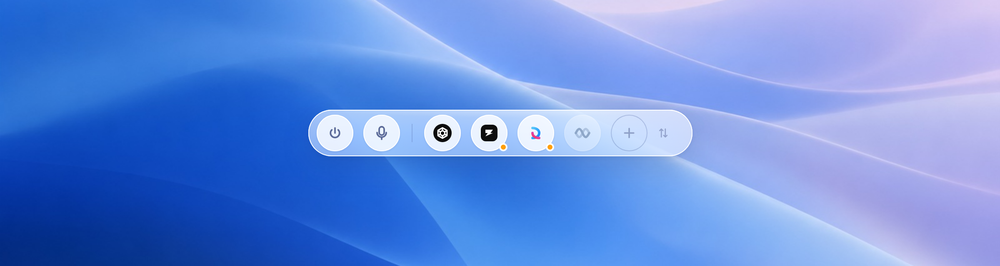

<div align="center">


# AgentDock

**A voice speed-dial for your personal AI agents — one Liquid Glass pill floating on the desktop.**

Treat ChatGPT dot, Grok Bot, Copilot, Devin and Muse as contacts:<br/>
one click to call, one click to mute, one click to hang up or hand the call to the next agent. Not a chat window. Not a model router.

[](#platforms)
[-6b7280?logo=windows&logoColor=white)](#platforms)
[](https://tauri.app)
[](src-tauri)
[](#testing)
[](LICENSE)

[中文](README.md) · [Features](#features) · [Install](#install) · [Shortcuts](#shortcuts) · [Architecture](#architecture) · [Connecting seats](#connecting-seats) · [Privacy](#privacy--limits) · [Roadmap](#roadmap)

<br/>



<sub>Light · idle. Left to right: collapse · system mute · seats (dot / Grok Bot / Copilot / Muse) · add seat · ⇅ orientation grip</sub>

</div>

---

## Why

Every AI vendor now ships its own "call me" mode — ChatGPT dot, xAI Grok Bot, Copilot Voice, Meta Muse, Devin. They live in five different apps and tabs, and nothing lets you **dial any of them in one click and switch mid-call** the way a phone contact list does.

AgentDock deliberately does one narrow thing:

- **Each agent is a seat, not a model.** You sign in to your own accounts; AgentDock only presses *call / mute / hang up* for you.
- **One pill**, Dynamic-Island-style states (dot / pet → pill → in-call), glass rendered by the OS.
- **Switch mid-call**: hang up the current agent, connect the next, undo within 3 s.
- **System-level mute** that works across every seat, independent of each site's own mute button.

## Features

<table>
<tr>
<td width="50%" valign="top">

**Calling & switching**

- Click a seat to call; click another seat during a call to switch (3 s undo)
- One-click mute / unmute (input-device level), one-click hang up
- After 15 s without a connection the pill enters *Needs you*, with one click to reveal that seat's page
- `⌥1…⌥9` to call / switch to seat n

**Forms**

- Dot / pet (seat avatar, GIF / APNG ok) / pill / in-call
- Auto-collapse after idle (3 / 8 / 15 / 30 s / never); hover the dot 0.3 s to expand
- Three collapse modes: auto · pinned expanded · pinned collapsed (hover = preview only)
- Never auto-collapses during a call

</td>
<td width="50%" valign="top">

**Position & orientation**

- Drag the pill's glass, the dot, or the end grip anywhere; the position is remembered
- Horizontal (Spotlight-like) / vertical (side-Dock-like), one click apart
- End grip shows ⇅ when horizontal, ⇄ when vertical: click to rotate, hold to move
- Rotation and expand/collapse morph around the same center — no jumps

**System integration**

- macOS 26 `NSGlassEffectView` (native Liquid Glass); `NSVisualEffectView` fallback on older releases
- Recordable global shortcuts with conflict detection; native context menu
- Light / dark / follow system, mirrored to the native glass layer
- Backward-compatible `settings.json`

</td>
</tr>
</table>

## Screenshots

> Rendered at 2x from the browser mock (controllable states). On macOS the glass is drawn by the system material and looks more translucent; real-device captures live in [docs/screenshots/mac-*](docs/screenshots).

<div align="center">

| In call | Muted |
|:--:|:--:|
|  |  |
| **Switching (3 s undo)** | **Grip hover (⇅ = click to stand up)** |
|  |  |
| **Collapsed: dot** | **Collapsed: pet** |
|  |  |

<br/>

| Vertical · idle | Vertical · in call | Dark |
|:--:|:--:|:--:|
|  |  | <br/><br/><br/><br/> |

<br/>

**Settings** — one sheet of system glass; sidebar more transparent, content brighter

| Seats | Appearance › Layout |
|:--:|:--:|
|  |  |
| **Shortcuts** | **Seats (dark)** |
|  |  |

</div>

## Install

### macOS (primary platform)

```bash
xcode-select --install
curl --proto '=https' --tlsv1.2 -sSf https://sh.rustup.rs | sh
brew install node

git clone https://github.com/we1jia/AgentDock.git && cd AgentDock
npm install
npm run tauri dev        # dev mode with HMR
npm run tauri build      # .app / .dmg → src-tauri/target/release/bundle/
```

On first launch an AgentDock icon appears in the menu bar and a small dot at the top center of the screen. `⌥Space` expands it; right-click the pill for the menu / settings.

| Requirement | Version |
|---|---|
| macOS | 26 Tahoe for native Liquid Glass; 13+ falls back to NSVisualEffectView |
| Rust | stable (1.80+) |
| Node | 20+ |

### Platforms

- **Windows** — code paths exist (Mica, UI Automation driver, `IAudioEndpointVolume` mute) but have **not been compiled or verified on a Windows machine yet**. PRs welcome.
- **Linux** — builds and runs (WebKitGTK, CSS glass fallback); used for development and CI: `bash tests/e2e_xvfb.sh`.

## Shortcuts

Global; all re-recordable under **Settings › Shortcuts**. The native context menu shows the current bindings.

| Shortcut | Action |
|---|---|
| `⌥ Space` | Expand / collapse (works during a call) |
| `⌥ M` | Mute / unmute (system level) |
| `⌥ Esc` | Hang up |
| `⌥ O` | Horizontal ↔ vertical |
| `⌥ P` | Collapsed form: dot ↔ pet |
| `⌥ 1…9` | Call / switch to seat n (order = drag order in Settings) |

Mouse:

| Gesture | Effect |
|---|---|
| Click a seat | Call; during a call = switch |
| Click the end grip ⇅ / ⇄ | Rotate |
| Drag the pill glass / dot / grip | Move; position remembered on release |
| Hover the dot for 0.3 s | Auto-expand |
| Right-click | Native menu: expand/collapse · orientation · dot/pet · settings · quit |

## Architecture

```
┌──────────────────────────── Tauri 2 ────────────────────────────┐
│  Dock window (transparent · borderless · never key)  Settings    │
│  src/dock.ts + dock.css                  src/settings.ts + .css │
│        │  invoke / events                        │               │
│  ──────┴──────────────────── Rust core ──────────┴─────────────  │
│  state.rs    Idle → Calling → InCall → Switching(3s) │ NeedsHuman │
│  seats.rs    seat model + seats.json      settings.rs  settings.json │
│  hotkeys.rs  global shortcuts + conflicts mic.rs       system mute   │
│  drivers/    drivers-as-data (JSON) · web.rs hidden webview · app.rs AX │
│  lib.rs      commands · tray · native material · cursor hover poll · probes │
└──────────────────────────────────────────────────────────────────┘
          │ NSGlassEffectView / NSVisualEffectView / Mica (system material)
          │ hidden WKWebView / WebView2 (one data directory per seat)
          └ input-device volume / IAudioEndpointVolume / pactl
```

**Principles**

- **The window is the glass shape.** The Dock window morphs with state and sizes itself to content; material, corner radius and shadow are drawn by the OS, the web layer only lays out symbols.
- **Drivers are data.** Each vendor's URL, login check, selectors and call / hang-up / mute steps live in [`src-tauri/drivers/*.json`](src-tauri/drivers); drop a higher-`version` copy in the user data directory to hot-update without rebuilding.
- **Invisible integration.** Web seats run in hidden, persistent webviews with isolated data directories; you log in once, everything after that is code-driven, no browser window ever pops up.
- **Hands off credentials.** The login window is the real site's login page and you complete it yourself (2FA / Passkey included); AgentDock never reads or stores passwords.

```
src-tauri/src
├── state.rs        pure state machine (incl. undoable switch)
├── seats.rs        seat model + persistence
├── settings.rs     appearance / position / orientation / collapse policy / shortcuts / mic
├── hotkeys.rs      global shortcut binding + conflict detection
├── mic.rs          system-level mute (macOS / Windows / Linux)
├── drivers/        mod.rs registry · web.rs hidden webview · app.rs desktop app (Accessibility)
└── lib.rs          Tauri commands, tray, system material, hover poll, probe loop
src-tauri/drivers/*.json   chatgpt-dot · grok-bot · copilot-voice · muse-voice · devin-voice
src/dock.ts + dock.css     the pill
src/settings.ts + .css     settings window (Seats / Shortcuts / Appearance / Microphone / About)
src/brand.ts               built-in brand marks; public/brand/<key>.svg overrides
tests/                     e2e_mock.py (browser E2E) · e2e_xvfb.sh (Linux real-binary smoke)
docs/ref/                  visual reference images + reproduction spec (SPEC.md)
```

## Connecting seats

| Seat | Mechanism | Status |
|---|---|---|
| ChatGPT dot | hidden webview · chatgpt.com | selectors to be pinned on a real device |
| Copilot Voice | hidden webview · copilot.microsoft.com | selectors to be pinned |
| Muse | hidden webview · muse.ai | selectors to be pinned |
| Devin | hidden webview · app.devin.ai | selectors to be pinned |
| Grok Bot | desktop app · macOS Accessibility | needs Accessibility permission; to be pinned |

**First connection (you do this once)**

1. Settings › Seats › **Sign in / Connect**: a real login window opens (the embedded browser, visible this one time). Sign in as usual; the window closes itself and the seat shows *Connected*.
2. macOS asks once to allow AgentDock to use the microphone — allow.
3. Click **Test call**: connect → 2 s → hang up. If it reports *no call detected*, pin the selectors as below.
4. Grok Bot: click **Grant Accessibility →** and tick AgentDock in System Settings.

**Pinning selectors (once per vendor)**

Selectors in the driver JSON are written from each site's public `aria-label`s and marked `"verified": false`. Use the same steps after a site redesign:

1. Settings › Seats › ⋯ › **Show background page** opens that seat's hidden page;
2. Right-click › Inspect Element, find stable attributes for call / mute / hang up;
3. Edit `src-tauri/drivers/<id>.json`, or drop a higher-`version` copy into
   `~/Library/Application Support/ai.we1jia.agentdock/drivers/` (no rebuild), then **Test call** again.

## Testing

```bash
cd src-tauri && cargo test                             # 23 unit tests: state machine / seats / settings compat / placement / hotkeys / drivers
npm run build                                          # type-check + bundle
npx vite --port 1420 & python3 tests/e2e_mock.py       # 27 browser E2E checks: state→DOM, orientation, drag, grip, auto-collapse, collapse modes, settings
bash tests/e2e_xvfb.sh                                 # Linux real-binary smoke (Xvfb)
DOCS_RS=1 cargo check --target aarch64-apple-darwin    # cross-check the macOS objc2 code from Linux
python3 .shots/shoot.py                                # regenerate the mock screenshots in docs/screenshots
```

Verified on a real Mac (macOS 26.6.2 · Apple Silicon): native `NSGlassEffectView`, no artifacts on theme change, zero-drift drag, position persists across restarts, orientation toggle, grip, auto-collapse and the three collapse modes, ⌥O / ⌥P / ⌥Space, native context menu.

## Privacy & limits

- **No credentials.** Login happens on the real site page, by you; cookies stay inside each seat's isolated webview data directory.
- **No uploads.** No server, no telemetry.
- **UI automation has limits.** None of the vendors expose a "call my agent" API, so everything goes through their UIs; redesigns require updating the driver JSON.
- **Still to verify on your device:** `getUserMedia` permission inside a hidden webview and WebRTC throttling while invisible. If a site blocks embedded login, the fallback is driving your local Chrome via CDP.
- **System mute** is skipped (UI state only) on machines without an audio input device.

## Roadmap

- [x] Three pill states · call / mute / hang up / switch / undo
- [x] Native macOS 26 Liquid Glass · light / dark / follow system
- [x] Drag anywhere · horizontal / vertical · ⇅/⇄ grip
- [x] Auto-collapse · three collapse modes · hover to expand
- [x] Recordable global shortcuts · native context menu
- [x] Settings: drag-sort seats · custom icons / GIF · shortcuts · appearance · microphone
- [ ] Pin selectors on real devices and flip `verified: true`
- [ ] Windows build + Mica verification
- [ ] Incoming-activity hint during a call (pill breathes when another seat has something to say)
- [ ] Signed & notarized .dmg releases

## Credits

Visual language follows the Apple Human Interface Guidelines and macOS Tahoe system controls (reference images and reproduction spec in [`docs/ref`](docs/ref)). Built on [Tauri 2](https://tauri.app), [window-vibrancy](https://github.com/tauri-apps/window-vibrancy) and [objc2](https://github.com/madsmtm/objc2).

## License

[MIT](LICENSE) © 2026 we1jia
