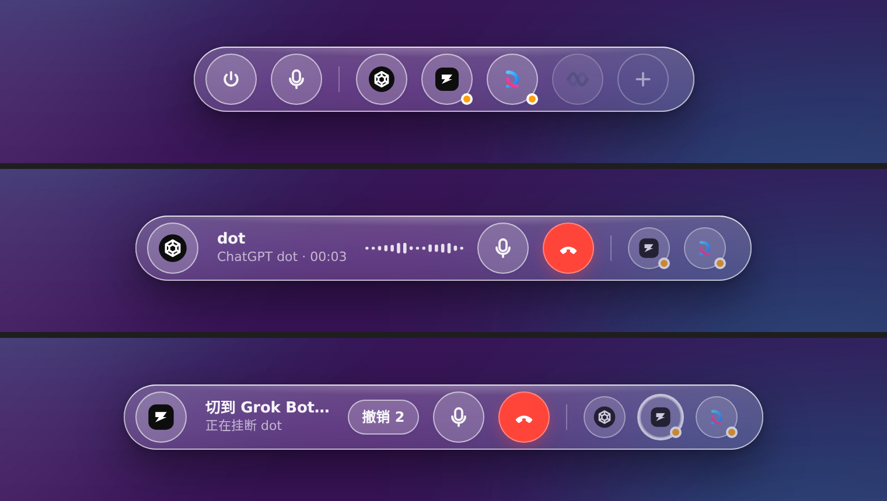

# AgentDock

一条悬浮在桌面上的「个人 agent 语音通讯录」。把你订阅的各家常驻 agent（ChatGPT dot、Grok Bot、Copilot、Devin、Muse）当成一排可呼叫的联系人：一键呼叫、一键闭麦、一键挂断或切到另一位。灵动岛式三级形态，玻璃由系统渲染（macOS 26 `NSGlassEffectView` Liquid Glass，老系统 `NSVisualEffectView`；Windows Mica）。

- 不固定位置：按住胶囊的玻璃空白处或小圆点拖到任意位置，松手即记忆（设置 › 外观 › 位置 = 自由）；也可选一个屏幕边缘吸附。
- 横向 / 竖向：设置 › 外观 › 方向。竖向时整条胶囊立起来像侧边 Dock，通话中波形与文字竖排；小圆点与宠物形态不受影响。
- 快捷切换：胶囊末端的把手（⋮）点一下横竖切换、按住拖动移动；⌥O 横/竖、⌥P 小圆点/宠物、⌥Space 展开/收起；右键胶囊有同样的原生菜单。
- 自动收起：空闲且鼠标不在上面 8 秒（可设 3/8/15/30 秒或从不）自动折回小圆点/宠物；鼠标停在圆点上 0.3 秒自动展开；通话中不收起。



## 在 Mac 上跑起来（第一次）

```bash
# 1. 工具链（已装可跳过）
xcode-select --install
curl --proto '=https' --tlsv1.2 -sSf https://sh.rustup.rs | sh
brew install node

# 2. 依赖
git clone https://github.com/we1jia/AgentDock.git && cd AgentDock
npm install

# 3. 开发模式运行（热更新）
npm run tauri dev

# 4. 打包成 .app / .dmg
npm run tauri build      # 产物在 src-tauri/target/release/bundle/
```

首次启动：菜单栏会出现 AgentDock 图标，屏幕顶部中央出现一个小圆点。⌥Space 展开；右键或长按任一席位打开设置。

### 第一次连接账号（需要你本人操作一次）

1. 设置 › 席位 › dot ›「登录」：弹出真实登录窗（内置浏览器），正常登录 chatgpt.com，完成后窗口自动收起，状态变为「已连接」。
2. 系统会弹一次「允许 AgentDock 使用麦克风」，允许。
3. 点「测试呼叫」：接通 → 2 秒 → 挂断。若提示「没检测到通话」，说明该站的按钮选择器需要在真机上钉一次（见下方「驱动」）。
4. Grok Bot 席位：点「授予辅助功能权限 →」跳到系统设置，勾选 AgentDock。
5. Copilot / Muse / Devin 同第 1 步。

## 结构

```
src-tauri/src
├── state.rs        纯状态机：Idle → Calling → InCall → Switching(3s 可撤销) / NeedsHuman
├── seats.rs        席位模型与持久化（seats.json）
├── settings.rs     外观 / 快捷键 / 麦克风设置（settings.json）
├── hotkeys.rs      全局快捷键绑定与冲突检测
├── mic.rs          系统级闭麦：macOS 输入音量 / Windows IAudioEndpointVolume / Linux pactl
├── drivers/
│   ├── mod.rs      驱动即数据：DriverSpec(JSON) + 探测/步骤脚本生成器 + 热更新 Registry
│   ├── web.rs      隐藏、常驻、独立数据目录的 webview 席位（无感）
│   └── app.rs      桌面 App 席位：macOS Accessibility（System Events）
└── lib.rs          Tauri 命令、托盘、系统材质、探测循环
src-tauri/drivers/*.json   每家的 URL、登录判定、按钮选择器、步骤
src/dock.ts + dock.css     Dock 条（窗口即玻璃形状，随状态形变并自适应窗口大小）
src/settings.ts + .css     设置窗（席位 / 快捷键 / 外观 / 麦克风 / 关于）
src/brand.ts               内置品牌标识；把官方 SVG 放到 public/brand/<key>.svg 自动优先
```

## 驱动（需要在真机上钉一次）

`src-tauri/drivers/*.json` 里的 CSS 选择器是按各家公开界面的 aria-label 写的猜测（`"verified": false`）。在 Mac 上：

1. 设置 › 席位 › ⋯ ›「查看后台页面」，打开该站的隐藏页面；
2. 右键 › 检查元素，找到通话 / 静音 / 挂断按钮的稳定属性；
3. 改 JSON（或放一份更高 `version` 的到 `~/Library/Application Support/ai.we1jia.agentdock/drivers/`，无需重新编译），再点「测试呼叫」。

Grok Bot 没有网页版，用 `AXButton[Start voice chat]` 这类 AX 选择器，通过 System Events 驱动，需要辅助功能权限。

## 测试

```bash
cd src-tauri && cargo test          # 状态机 / 席位 / 设置 / 放置 / 快捷键 / 驱动 22 个单元测试
npm run build                        # 前端类型检查 + 打包
npx vite --port 1420 & python3 tests/e2e_mock.py   # 浏览器 mock E2E 20 项（状态机→DOM、竖向、拖拽、设置页）
bash tests/e2e_xvfb.sh               # Linux 真实二进制冒烟（xvfb）
DOCS_RS=1 cargo check --target aarch64-apple-darwin  # 在 Linux 上交叉检查 macOS objc2 代码
python3 .shots/shoot.py              # 浏览器 mock 下的 Dock 与设置页截图（深浅色）
```

## 已知边界

- 四家都没有公开「呼叫我的 agent」接口，全部走界面自动化；界面改版需更新驱动。
- 隐藏 webview 的 getUserMedia 授权、不可见时 WebRTC 是否被节流，需在 Mac 上实测；若某站拦截，退化为控制本机 Chrome（CDP）。
- Windows：代码路径已写（Mica、UIA、IAudioEndpointVolume），未在 Windows 上编译验证。
