<div align="center">

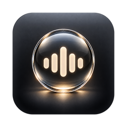

# AgentDock

**你的个人 AI agent 语音通讯录 —— 一条悬浮在桌面上的 Liquid Glass 拨号盘。**

把 ChatGPT dot、Grok Bot、Copilot、Devin、Muse 当成一排可呼叫的联系人：<br/>
一键呼叫 · 一键闭麦 · 一键挂断或切到下一位。不是聊天窗口，不是模型路由器。

[](#平台) [-6b7280?logo=windows&logoColor=white)](#平台) [](https://tauri.app) [](src-tauri) [](#测试) [](LICENSE)

[English](README.en.md) · [功能](#功能) · [安装](#安装) · [快捷键](#快捷键) · [架构](#架构) · [接入席位](#接入席位) · [隐私](#隐私与边界) · [路线图](#路线图)

<br/>

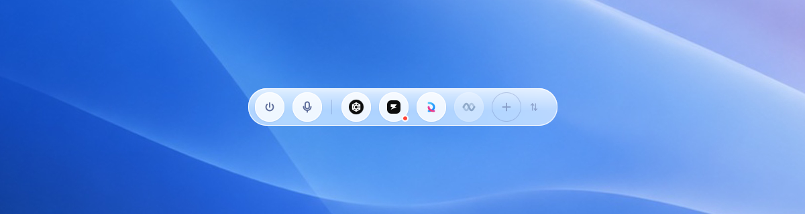
<br/>

<p><sub>macOS 26 真机实拍 · 原生 NSGlassEffectView。胶囊从左到右：收起 · 系统闭麦 · 席位（dot / Grok Bot / Copilot / Muse）· 添加席位 · ⇅ 方向把手</sub></p>

</div>

---

## 为什么做它

每家 AI 都有了自己的「打电话」：ChatGPT 的 dot、xAI 的 Grok Bot、Copilot Voice、Meta Muse、Devin。但它们散落在五个 App 和网页里，没有一个地方能像手机通讯录那样**一键呼叫、随手换人**。

AgentDock 做的事情很窄：

- **每位 agent 是一个席位**，不是一个模型。你登录你自己的账号，AgentDock 只负责按下「通话 / 静音 / 挂断」。
- **一条胶囊**，灵动岛式三级形态（小圆点 / 宠物 → 胶囊 → 通话态），玻璃由系统渲染。
- **通话中可以直接切到另一位**：当前通话挂断、下一位接通，3 秒内可撤销。
- **系统级闭麦**：一键对所有席位生效，不依赖各家网页里的静音按钮。

## 功能

<table>
<tr>
<td width="50%" valign="top">

**呼叫与切换**

- 点席位呼叫；通话中点另一位 = 切换（3 秒可撤销）
- 一键闭麦 / 开麦（系统输入设备级）、一键挂断
- 15 秒未接通自动进入「需要你看一眼」，可一键查看该席位的后台页面
- ⌥1…⌥9 直接呼叫 / 切换到第 n 席

**形态**

- 小圆点 / 宠物（席位头像，可用 GIF / APNG）/ 胶囊 / 通话态
- 空闲自动收起（3 / 8 / 15 / 30 秒 / 从不），鼠标停在圆点 0.3 秒自动展开
- 收起方式三档：自动 · 固定展开 · 固定收起（hover 只预览）
- 通话中永不自动收起

</td>
<td width="50%" valign="top">

**位置与方向**

- 按住胶囊玻璃处 / 小圆点 / 末端把手拖到任意位置，松手即记忆
- 横向（Spotlight 式）/ 竖向（侧边 Dock 式）一键切换
- 末端把手：横向显示 ⇅、竖向显示 ⇄，点一下切方向、按住拖动
- 横竖切换与展开收起都围绕同一中心形变，不跳位

**系统集成**

- macOS 26 `NSGlassEffectView`（原生 Liquid Glass），老系统回退 `NSVisualEffectView`
- 全局快捷键可录制、冲突检测；原生右键菜单
- 浅色 / 深色 / 跟随系统，原生玻璃层随之同步
- 旧版 `settings.json` 向后兼容

</td>
</tr>
</table>

## 截图

### macOS 26 真机实拍

> 文件名 `mac-*`，macOS 26.6.2 · Apple Silicon，玻璃由系统 `NSGlassEffectView` 绘制。云端 Mac 无 HiDPI 显示器，因此为 1x 实拍（像素 = pt），未做放大。

<div align="center">

| 空闲 · 浅色 | 空闲 · 深色 |
|:--:|:--:|
| 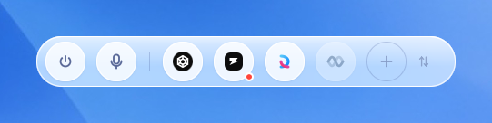 | 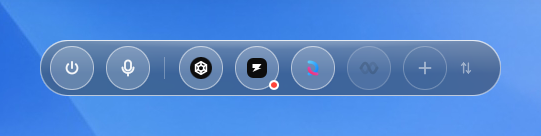 |
| **通话中** | **闭麦** |
| 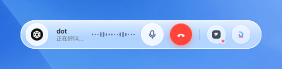 | 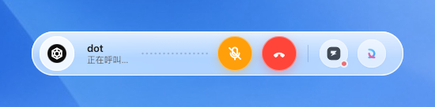 |
| **切换席位（3 秒可撤销）** | **把手悬停 ⇅** |
| 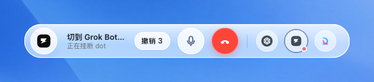 | 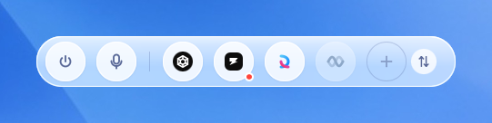 |
| **右键原生菜单（标注当前快捷键）** | **小圆点 / 宠物 / 竖向** |
| 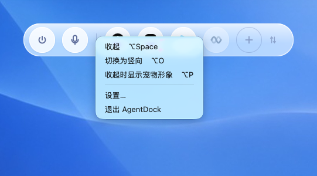 | 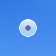 &nbsp; 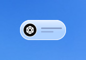 &nbsp; 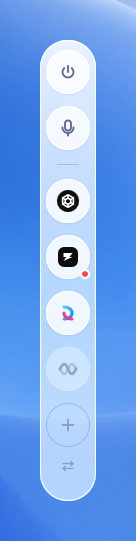 &nbsp; 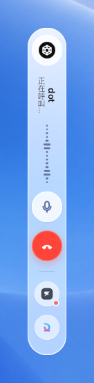 |

<br/>

| 设置 › 席位 | 设置 › 外观（布局 · 收起方式） |
|:--:|:--:|
| 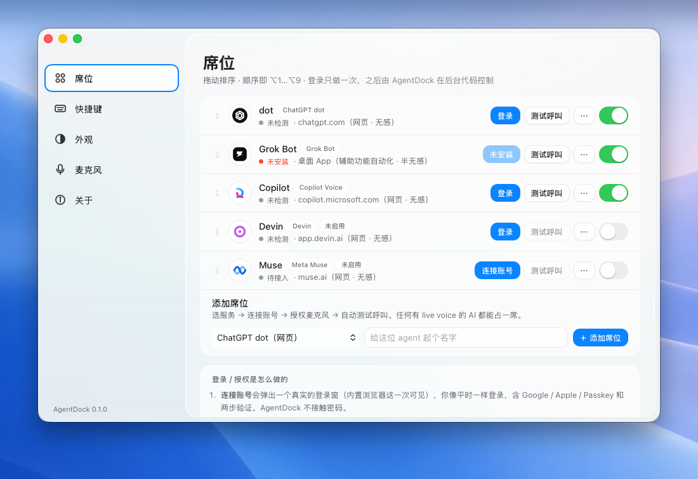 | 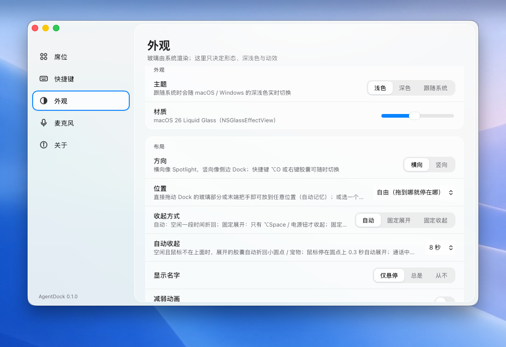 |
| **设置 › 快捷键** | **设置 › 席位（深色）** |
| 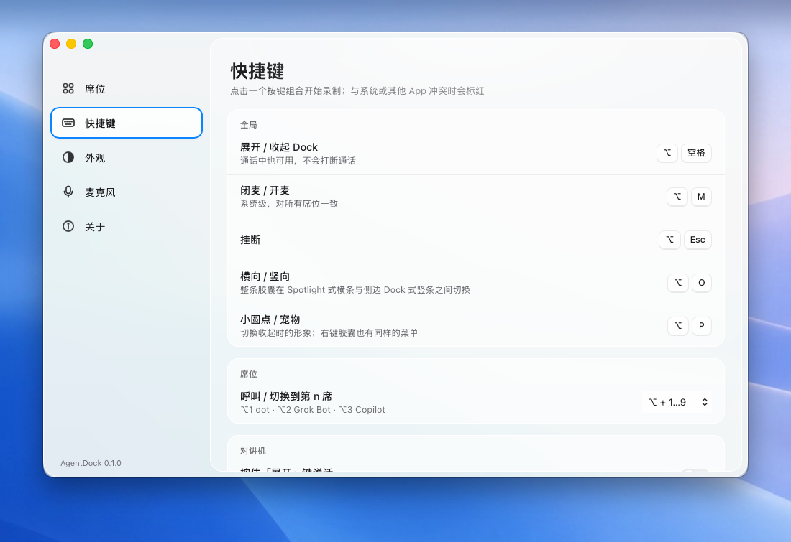 | 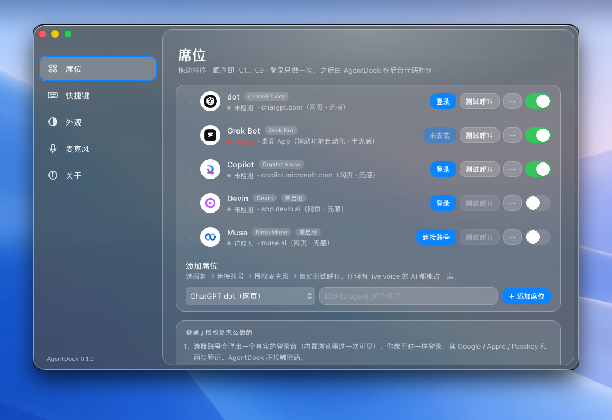 |

</div>

### 状态总览（浏览器 mock · 2x）

> 以下由浏览器 mock 以 2x 渲染（状态可控、便于逐项对比）；真机上玻璃由系统材质绘制，更通透。

<div align="center">

| 通话中 | 闭麦 |
|:--:|:--:|
| 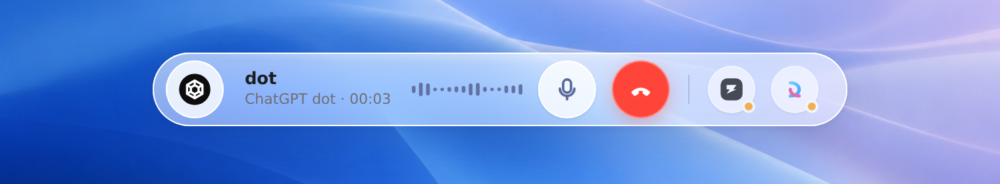 |  |
| **切换席位（3 秒可撤销）** | **把手悬停（⇅ = 点一下立起来）** |
| 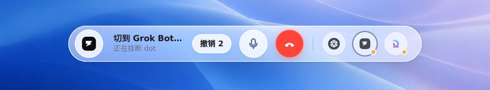 |  |
| **收起：小圆点** | **收起：宠物** |
|  |  |

<br/>

| 竖向 · 空闲 | 竖向 · 通话中 | 深色 |
|:--:|:--:|:--:|
| 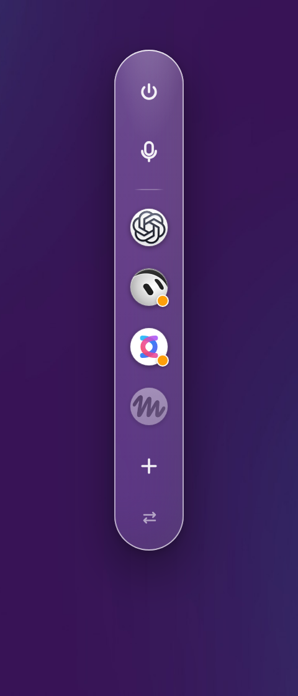 | 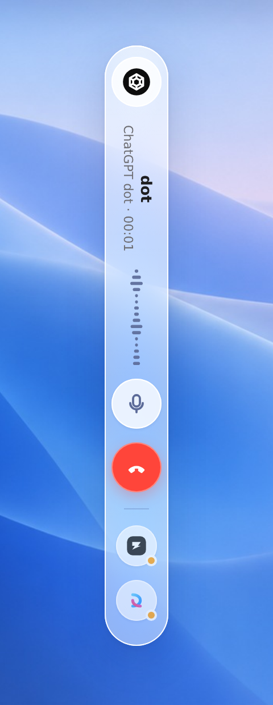 | <br/><br/><br/><br/> |

<br/>

**设置窗** —— 一整块系统玻璃，左栏更透、右栏更亮

| 席位 | 外观 › 布局 |
|:--:|:--:|
| 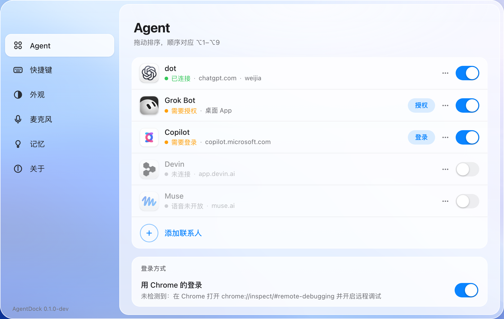 | 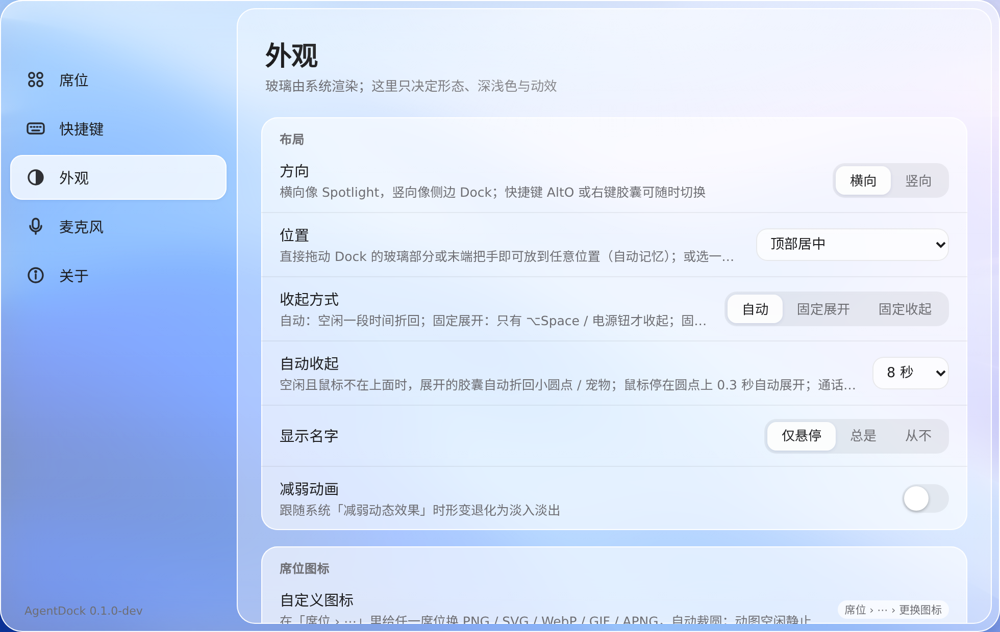 |
| **快捷键** | **席位（深色）** |
| 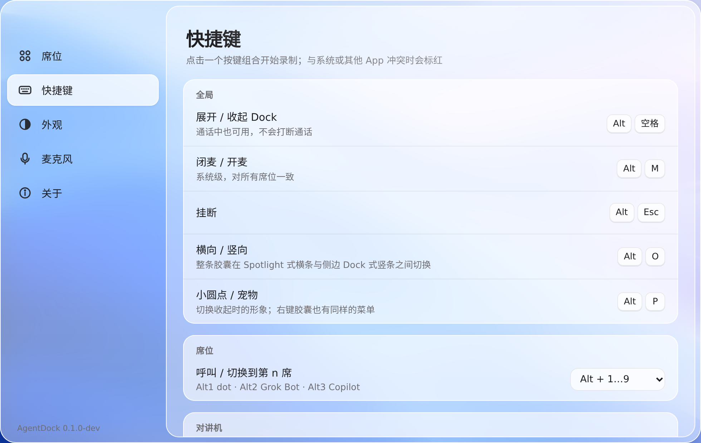 | 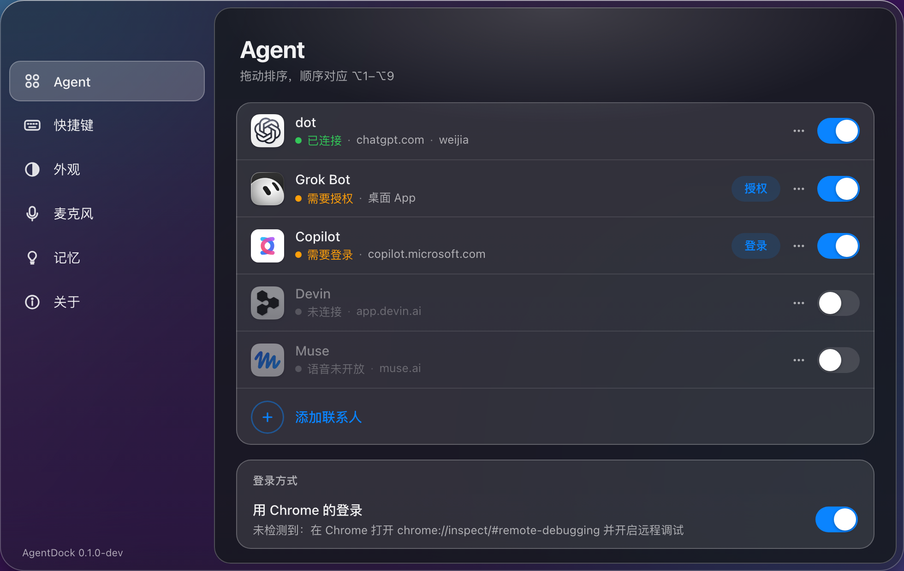 |

</div>

## 安装

### macOS（推荐，首发平台）

```bash
# 工具链（已装可跳过）
xcode-select --install
curl --proto '=https' --tlsv1.2 -sSf https://sh.rustup.rs | sh
brew install node

git clone https://github.com/we1jia/AgentDock.git && cd AgentDock
npm install
npm run tauri dev        # 开发模式（热更新）
npm run tauri build      # 打包 .app / .dmg → src-tauri/target/release/bundle/
```

首次启动：菜单栏出现 AgentDock 图标，屏幕顶部中央出现一个小圆点。`⌥Space` 展开，右键胶囊打开菜单 / 设置。

| 要求 | 版本 |
|---|---|
| macOS | 26 Tahoe 起为原生 Liquid Glass；13+ 回退到 NSVisualEffectView |
| Rust | stable（1.80+） |
| Node | 20+ |

### Windows

代码路径已就位（Mica 材质、UI Automation 驱动、`IAudioEndpointVolume` 闭麦），**尚未在 Windows 实机编译验证**。欢迎 PR。

### Linux

可编译运行（WebKitGTK，CSS 玻璃回退）。主要用于开发与 CI：`bash tests/e2e_xvfb.sh`。

## 快捷键

全局，均可在 **设置 › 快捷键** 重新录制；右键胶囊 / 小圆点的原生菜单会显示当前绑定。

| 快捷键 | 动作 |
|---|---|
| `⌥ Space` | 展开 / 收起 Dock（通话中也可用） |
| `⌥ M` | 闭麦 / 开麦（系统级） |
| `⌥ Esc` | 挂断 |
| `⌥ O` | 横向 ↔ 竖向 |
| `⌥ P` | 收起形象：小圆点 ↔ 宠物 |
| `⌥ 1…9` | 呼叫 / 切换到第 n 席（顺序 = 设置里的拖拽顺序） |

鼠标：

| 操作 | 效果 |
|---|---|
| 点席位 | 呼叫；通话中 = 切换 |
| 点末端把手 ⇅ / ⇄ | 横竖切换 |
| 按住胶囊玻璃处 / 小圆点 / 把手拖动 | 移动 Dock，松手记忆位置 |
| 鼠标停在小圆点 0.3 秒 | 自动展开 |
| 右键 | 原生菜单：展开/收起 · 方向 · 小圆点/宠物 · 设置 · 退出 |

## 架构

```
Tauri 2
├─ Dock 窗口（透明 · 无边框 · 不抢焦点）        src/dock.ts + dock.css
├─ 设置窗口（透明）                              src/settings.ts + settings.css
│      │ invoke / events
└─ Rust core
   ├─ state.rs     状态机 Idle → Calling → InCall → Switching(3s 可撤销) | NeedsHuman
   ├─ seats.rs     席位模型 + seats.json
   ├─ settings.rs  外观 / 位置 / 方向 / 收起策略 / 快捷键 → settings.json
   ├─ hotkeys.rs   全局快捷键 + 冲突检测
   ├─ mic.rs       系统级闭麦
   ├─ drivers/     驱动即数据（JSON）· web.rs 隐藏 webview · app.rs Accessibility
   └─ lib.rs       命令 · 托盘 · 原生材质 · 光标 hover 轮询 · 探测循环
          │
          ├─ NSGlassEffectView / NSVisualEffectView / Mica   （系统材质）
          ├─ 隐藏 WKWebView / WebView2                        （每席位独立数据目录）
          └─ 系统输入设备音量 / IAudioEndpointVolume / pactl  （闭麦）
```

**设计原则**

- **窗口即玻璃形状。** Dock 窗口随状态形变并自适应内容大小；材质、圆角、阴影由系统绘制，前端只负责布局与符号。
- **驱动即数据。** 每家的 URL、登录判定、按钮选择器、呼叫 / 挂断 / 静音步骤都在 [`src-tauri/drivers/*.json`](src-tauri/drivers)；放一份更高 `version` 的到用户目录即可热更新，无需重新编译。
- **无感接入。** 网页型席位跑在隐藏、常驻、独立数据目录的 webview 里；登录只做一次，之后全部代码控制，不弹任何浏览器窗口。
- **不碰凭据。** 登录窗就是真实的站点登录页，由你本人完成（含 2FA / Passkey）；AgentDock 不读取、不存储密码。

```
src-tauri/src
├── state.rs        纯状态机（含撤销切换）
├── seats.rs        席位模型与持久化
├── settings.rs     外观 / 位置 / 方向 / 收起策略 / 快捷键 / 麦克风
├── hotkeys.rs      全局快捷键绑定与冲突检测
├── mic.rs          系统级闭麦（macOS / Windows / Linux）
├── drivers/        mod.rs 注册表 · web.rs 隐藏 webview · app.rs 桌面 App (Accessibility)
└── lib.rs          Tauri 命令、托盘、系统材质、hover 轮询、探测循环
src-tauri/drivers/*.json   chatgpt-dot · grok-bot · copilot-voice · muse-voice · devin-voice
src/dock.ts + dock.css     Dock 条
src/settings.ts + .css     设置窗（席位 / 快捷键 / 外观 / 麦克风 / 关于）
src/brand.ts               内置品牌标识；public/brand/<key>.svg 可覆盖
tests/                     e2e_mock.py（浏览器 E2E）· e2e_xvfb.sh（Linux 真实二进制冒烟）
docs/ref/                  视觉参考图与还原规格（SPEC.md）
```

## 接入席位

| 席位 | 方式 | 状态 |
|---|---|---|
| ChatGPT dot | 隐藏 webview · chatgpt.com | 选择器待真机钉定 |
| Copilot Voice | 隐藏 webview · copilot.microsoft.com | 选择器待真机钉定 |
| Muse | 隐藏 webview · muse.ai | 选择器待真机钉定 |
| Devin | 隐藏 webview · app.devin.ai | 选择器待真机钉定 |
| Grok Bot | 桌面 App · macOS Accessibility | 需辅助功能权限，待真机钉定 |

**首次连接（需要你本人操作一次）**

1. 设置 › 席位 › **登录 / 连接账号**：弹出真实登录窗（内置浏览器这一次可见），像平时一样登录，完成后自动收起，状态变为「已连接」。
2. 系统弹一次「允许 AgentDock 使用麦克风」，允许。
3. 点 **测试呼叫**：接通 → 2 秒 → 挂断。若提示「没检测到通话」，按下面步骤钉一次选择器。
4. Grok Bot：点 **授权辅助功能 →** 跳到系统设置勾选 AgentDock。

**钉定选择器（每家做一次）**

驱动 JSON 里的 CSS 选择器按各站公开界面的 `aria-label` 编写，标记为 `"verified": false`，站点改版后也用同样方法更新：

1. 设置 › 席位 › ⋯ › **查看后台页面**，打开该站的隐藏页面；
2. 右键 › 检查元素，找到通话 / 静音 / 挂断按钮的稳定属性；
3. 改 `src-tauri/drivers/<id>.json`，或放一份更高 `version` 的到
   `~/Library/Application Support/ai.we1jia.agentdock/drivers/`（无需重新编译），再点「测试呼叫」。

## 测试

```bash
cd src-tauri && cargo test                             # 23 个单元测试：状态机 / 席位 / 设置兼容 / 放置 / 快捷键 / 驱动
npm run build                                          # 前端类型检查 + 打包
npx vite --port 1420 & python3 tests/e2e_mock.py       # 27 项浏览器 E2E：状态机→DOM、横竖、拖拽、把手、自动收起、三档收起、设置页
bash tests/e2e_xvfb.sh                                 # Linux 真实二进制冒烟（Xvfb）
DOCS_RS=1 cargo check --target aarch64-apple-darwin    # 在 Linux 上交叉检查 macOS objc2 代码
python3 .shots/shoot.py                                # 重新生成 docs/screenshots 下的 mock 截图
```

真机验证记录（macOS 26.6.2 · Apple Silicon）：原生 `NSGlassEffectView` 材质、主题切换无残影、拖拽零漂移、重启位置保留、横竖切换、把手、自动收起与三档收起、⌥O / ⌥P / ⌥Space、原生右键菜单。

## 隐私与边界

- **不接触密码。** 登录发生在真实站点页面，由你完成；cookie 留在各席位独立的 webview 数据目录里。
- **不上传任何数据。** 没有服务端，没有遥测。
- **界面自动化的天然边界。** 四家都没有公开「呼叫我的 agent」接口，全部走界面自动化；界面改版需要更新驱动 JSON。
- **待实测项。** 隐藏 webview 的 `getUserMedia` 授权与不可见时的 WebRTC 节流需在你登录后的真机上验证；若某站拦截内嵌登录，退化为控制本机 Chrome（CDP）。
- **系统级闭麦**在没有音频输入设备的机器上会跳过（只切换 UI 状态）。

## 路线图

- [x] Dock 三态 · 呼叫 / 闭麦 / 挂断 / 切换 / 撤销
- [x] macOS 26 原生 Liquid Glass · 浅深色 · 跟随系统
- [x] 任意位置拖拽 · 横向 / 竖向 · ⇅/⇄ 把手
- [x] 自动收起 · 三档收起方式 · hover 展开
- [x] 全局快捷键（可录制）· 原生右键菜单
- [x] 设置窗：席位拖拽排序 · 自定义图标 / GIF · 快捷键 · 外观 · 麦克风
- [ ] 各站选择器真机钉定并标记 `verified: true`
- [ ] Windows 实机编译与 Mica 验证
- [ ] 通话中来电提示（另一席位有消息时胶囊轻微呼吸）
- [ ] 签名与公证的 .dmg 发布

## 致谢

视觉以 Apple Human Interface Guidelines 与 macOS Tahoe 系统控件为准（参考图与还原规格见 [`docs/ref`](docs/ref)）。基于 [Tauri 2](https://tauri.app)、[window-vibrancy](https://github.com/tauri-apps/window-vibrancy)、[objc2](https://github.com/madsmtm/objc2)。

## 许可证

[MIT](LICENSE) © 2026 we1jia
